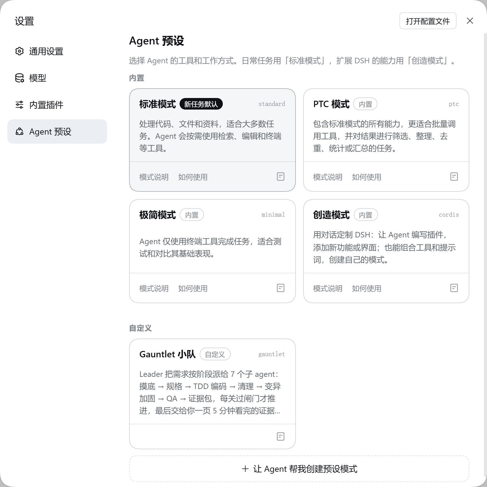
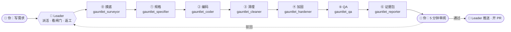
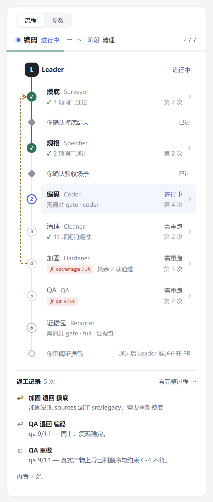
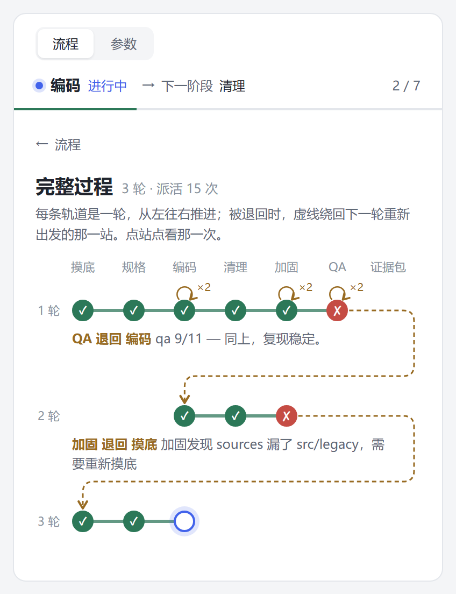
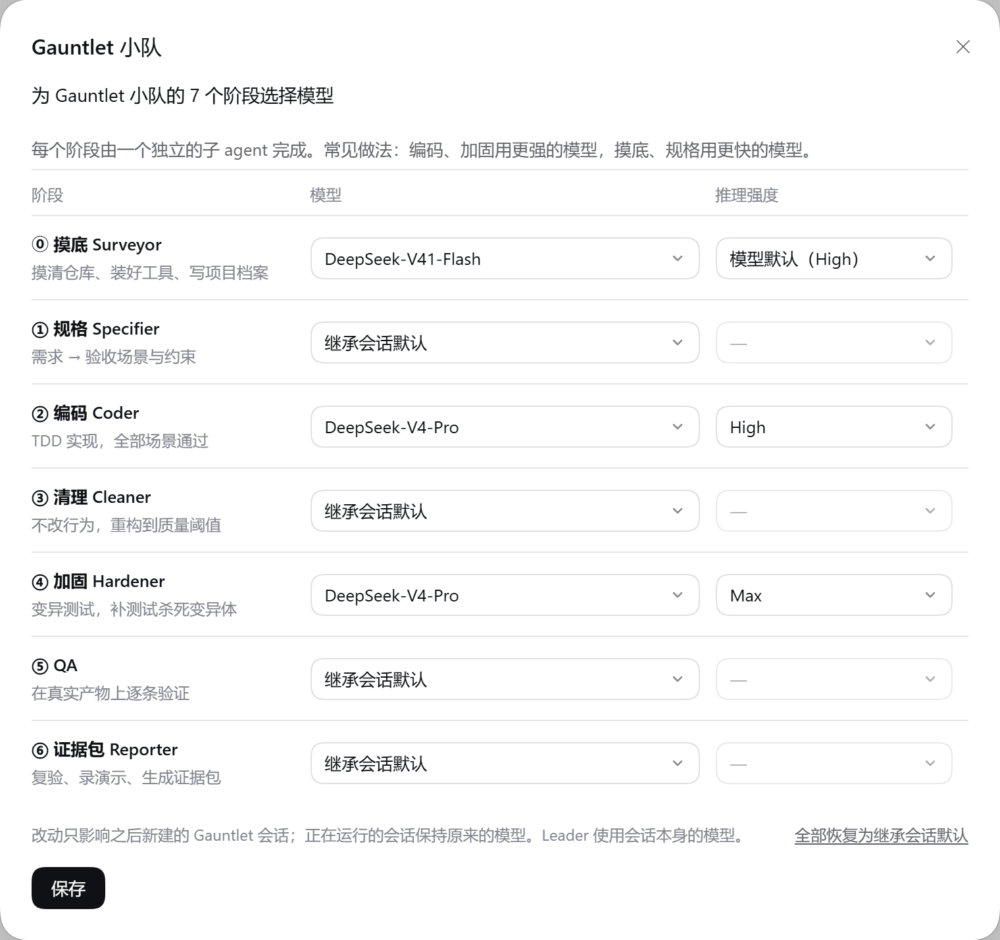

<h1 align="center">Gauntlet · dsh-crap-agents</h1>

<p align="center">
  <b>DeepSeek Harness 插件：让一支 AI 小队按 Bob 大叔的方法写代码——<br>
  需求 → 验收测试 → TDD → 全量代码质量 → 变异测试 → QA，最后交给你一页 5 分钟看完的证据包。</b>
</p>

<p align="center">
  
  
  
  
  
</p>

> **人不读 AI 写的代码，人读证据。**
> 与其逐行审查，不如把 agent 关进一层层**可度量的闸门**：每个 agent 只做一件事，做完就把证据交出来；
> 人只负责定需求、画边界、看最后的证据。

这是 [multica-crap-agents](https://github.com/Iamtianyuyang/multica-crap-agents) 移植到 **DeepSeek Harness（dsh）** 的插件版本：
同一条流水线、同一套零依赖工具和离线证据包，做成 dsh 的一个 **Agent 预设（模式）**，用 dsh 的技能和子代理（subagent）来组队。

## 安装

```bash
dsh plugin --profile web add github:Iamtianyuyang/dsh-crap-agents
```

然后重启 `dsh web` 并刷新页面；`dsh plugin --profile web list` 里会出现 `dsh-gauntlet`。
用桌面版 DeepSeek Harness 的话，把 `--profile web` 换成 `--profile desktop`，装完重启应用。
本地开发：在仓库目录里 `dsh plugin --profile web add "link:$(pwd)"`，改完刷新即可。

> 需要目标机器有 git、Node 18.17+（dsh 自带的 runtime 已满足）、代码图工具 [codebase-memory-mcp](https://github.com/DeusData/codebase-memory-mcp)，
> 以及项目自己平时构建 / 测试用的工具。代码图工具是必需的（`doctor` 会检查）：
>
> ```bash
> npm install -g codebase-memory-mcp
> ```

装好后会得到：

- **「Gauntlet 小队」模式**：在 Agent 预设的「自定义」分组里。新建任务时选它，主会话 agent 就是 Leader；
  其他模式（标准、PTC……）完全不受影响——小队的技能和工具只存在于这个模式里。
- **「Gauntlet 小队」设置页**：给 7 个阶段分别选模型。两个入口：Gauntlet 模式下输入框左下角的「阶段模型」按钮（悬浮窗），
  或侧栏「插件」→「已安装」→ dsh-gauntlet。
- **「流程进度」面板**：Gauntlet 主会话里显示每个阶段要过的闸门和结果、人类闸门、返工的来龙去脉，以及整个循环的线路图（见下文）。
- **环境变量 `DSH_GAUNTLET_KIT_DIR`**：Gauntlet 会话里的每次 shell 调用都能拿到，指向插件自带的零依赖工具本体，
  一行把 `.gauntlet/` 装进目标仓库（离线）。

<p align="center">
  
  <br><sub>设置 → Agent 预设：「Gauntlet 小队」在「自定义」分组里，和内置模式并列</sub>
</p>

## 这支小队怎么组成的

选了「Gauntlet 小队」模式的会话里，主会话 agent 是 **Leader（编排者）**：它的系统提示就是编排协议（[`prompts/leader.md`](prompts/leader.md)）。
它把需求**按阶段派给 7 个阶段子 agent**；每个子 agent 在同一个工作目录（目标仓库）里干自己那一个阶段，
跑完对应闸门、把证据交回来，Leader 过关才推进，不过就返工。



| 阶段 | 子代理工具 | 阶段技能 | 必须通过的闸门 |
|---|---|---|---|
| ⓪ 摸底 | `gauntlet_surveyor` | `gauntlet-survey` | `doctor` 全绿、`test` 跑完、写好 `.gauntlet/GAUNTLET.md` |
| ① 规格 | `gauntlet_specifier` | `gauntlet-specify` | `gate --profile specifier` |
| ② 编码 | `gauntlet_coder` | `gauntlet-tdd` | `gate --profile coder` |
| ③ 清理 | `gauntlet_cleaner` | `gauntlet-clean` | `gate --profile cleaner` |
| ④ 加固 | `gauntlet_hardener` | `gauntlet-harden` | `gate --profile hardener` |
| ⑤ QA | `gauntlet_qa` | `gauntlet-qa` | QA 报告全部通过 |
| ⑥ 证据包 | `gauntlet_reporter` | `gauntlet-report` | `gate --profile full` |

每个阶段子 agent 先读共同规则 `gauntlet-core`，再按项目 `.gauntlet/gauntlet.config.json` 的 `adapter`
读一个工具链片段（`gauntlet-adapter-commands` 通用 / `gauntlet-adapter-cmake` 深度分析）。

几条贯穿全程的规矩：

- **子 agent 不需要你的审批。** dsh 里被委派的子 agent 碰到需要审批的操作会被自动拒绝；Gauntlet 的阶段 agent
  遇到这种情况（缺工具、要联网下载……）会把**确切的命令**交回 Leader，Leader 拿给你批准后代为执行，再让那个阶段重来。
- **推送和 PR 在你说"通过"之后。** 证据包阶段只在本地分支提交；你审阅通过，Leader 才 `git push` 并开 PR。被驳回的工作不会被推送。
- **进度不靠记忆。** Leader 用 todo 列表和 git 提交（带 `[code]`、`[clean]` 等阶段标签）记进度；子 agent 每次测试变绿就提交。
  某个阶段被中断（取消、撞到 token 上限、dsh 重启）时，Leader 会让它从仓库现状继续，而不是当作失败。

## 流程进度

「Gauntlet 小队」主会话右侧的面板，从会话顶部的「流程」按钮打开。它回答三个问题：**现在在哪、哪里要过关、哪里返工了。**

<table>
  <tr>
    <td align="center" valign="top" width="50%">
      
      <br><sub><b>总览</b>：每一站要过的闸门、结果，和最近一次退回</sub>
    </td>
    <td align="center" valign="top" width="50%">
      
      <br><sub><b>完整过程</b>：三轮循环，每次退回去了哪、为什么</sub>
    </td>
  </tr>
</table>

- **总览**：Leader、七个阶段和三处人类闸门（◇ 确认摸底、可选的确认规格、最终审阅证据包）依次排在竖轴上。
  每个阶段写明要过的闸门（如 `gate · coder`）；跑过之后，全过只写一句「✓ 11 项闸门通过」，有失败只列失败项（`✗ coverage 71%`）。
  最近一次退回画成轨道左侧的回流箭头；被退回作废的后续阶段显示「需重跑」。有阶段在等你时，顶部出现「需要你处理」。
- **返工记录**：最新在前，连续相同的合并计数，写明谁退回给谁、为什么。原因依次取 Leader 派活时的「返工说明」、
  上一轮失败的闸门和摘要、Leader 写的任务描述。
- **完整过程**（返工记录右上角「看完整过程」）：每一轮是一条从左往右穿过七站的轨道；被退回时，虚线从出问题的那一站绕回下一轮重新出发的那一站，
  旁边写着原因；同一阶段在一轮内重做，站点上方有个小回环和次数。打开时按顺序把路线画出来（系统开了"减少动态效果"就直接显示）。
- **阶段详情**：点任一阶段或站点，面板整页切到那一次的详情，「← 流程」返回原处。直接展开闸门结果、结论（摘要、分支、收敛记录、后续提示）、
  全部尝试（每次的状态、失败的闸门，以及「同阶段重做 / 由 QA 退回 / 中断后继续」和原因）和质量指标；
  派发任务、子 agent 的发言与工具调用、完整返回内容放在最后的「原始记录」折叠里。

状态随阶段工具调用、`GAUNTLET-RESULT` 和 Leader 的 todo 更新：未开始、进行中、已通过、需返工、等待确认、已中断、待核实、需重跑。
截图里的数据是 [`scripts/preview-diagram.mjs`](scripts/preview-diagram.mjs) 的示例，它用 `lib/client.js` 里的真实组件渲染静态预览（`node scripts/preview-diagram.mjs`，输出到 `.preview/`）。

面板的「参数」页可编辑 CRAP、函数复杂度、函数行数、参数数、行覆盖率、变异杀死率等 12 项质量阈值，以及每个阶段的模型和推理强度。质量阈值保存到会话项目的 `.gauntlet/gauntlet.local.json`（老布局的项目是根目录的 `gauntlet.local.json`），仅修改编辑过的字段并保留其他配置；文件在别处更新时会提示冲突。质量改动供之后的工具运行读取，模型改动用于之后新建的 Gauntlet 会话。

质量参数使用会话的项目根目录。如果会话从子目录打开、配置位于父级项目目录，面板会提示以项目根目录打开后编辑，避免生成工具不会读取的本地配置。
记录可折叠但不会截断；可以加载更早的子会话记录，或直接打开原子会话。回退重做后，下游阶段的旧结果会标成「需重跑」。
会话历史未完整加载时，面板会注明；可点「加载更早记录」补齐前面的执行详情。

函数详情提供搜索，分别展示 AST / 覆盖率分支复杂度、行覆盖率、CRAP 风险值和变异杀死率，并保留每个变异体、测试、QA、阈值和原始报告。函数变异分数按源码行范围汇总，会注明推导方式；缺少数据时显示「未测量」。
阶段结束后，插件在 `.gauntlet/out/workflow/<callId>/reports.json` 保存当时的指标快照（界面关闭也会保存）。旧执行没有快照时明确说明，不用后续阶段的报告冒充历史数据。面板底部也可查看注明来源的工作区最新报告。
快照单个报告限制 4 MiB、整体限制 16 MiB；超限或读取失败会保留错误说明。前台阶段执行才记录完成快照，后台启动确认不视为完成。

## 每个阶段自己选模型

在 Gauntlet 模式的输入框里点「阶段模型」按钮（只在这个模式下出现），或者打开侧栏「插件」→「已安装」→ dsh-gauntlet：
7 个阶段各一行，选模型和推理强度，保存。按钮上会显示有几个阶段用了自定义模型。

<p align="center">
  
  <br><sub>「阶段模型」悬浮窗：例如摸底用 Flash，编码 / 加固用 V4-Pro 并调高推理强度，其余继承会话默认</sub>
</p>

- 「继承会话默认」→ 用会话本身的模型（Leader 始终用会话模型）。
- 下拉框里只有当前真正可用的模型；以前保存的模型不再可用时会单独列在「已保存但当前不可用」里，提醒你换掉。
- 改动只影响**之后新建**的 Gauntlet 会话；正在跑的会话保持原来的模型。
- 常见做法：编码 / 加固用更强的模型，摸底 / 规格用更快的模型。

不用界面也可以：写进 profile 的 `cordis.patch.yml`（会替换 `gauntlet` 这一行的整份配置）：

```yaml
- id: gauntlet
  name: dsh-gauntlet
  config:
    stages:
      coder:    { provider: deepseek, model: deepseek-reasoner, reasoningEffort: high }
      hardener: { provider: deepseek, model: deepseek-reasoner }
```

阶段 key：`surveyor` `specifier` `coder` `cleaner` `hardener` `qa` `reporter`。

## 用起来

把目标仓库在 dsh 里打开，新建任务时选「Gauntlet 小队」模式，然后直接说需求，例如：

> 做一个命令行工具，在阿拉伯数字和罗马数字之间互相转换……

Leader 会：建工作分支，先让 `gauntlet_surveyor` 摸底并（第一次接入仓库时）停下来请你确认规则，再依次走规格、编码、清理、加固、QA，
最后 `gauntlet_reporter` 生成**单文件离线证据包** `.gauntlet/out/evidence/index.html` 交给你审阅。你回复"通过"后，Leader 推送分支并开 PR。

### Windows 上的三个 shell

| 谁执行命令 | Windows | Linux / macOS |
|---|---|---|
| agent 自己（shell 工具） | PowerShell | bash |
| `.gauntlet/gauntlet.config.json` 的 `commands` | cmd.exe | /bin/sh |
| `.gauntlet/demo/*.json` 的 `run` | Git Bash | /bin/sh |

技能里的命令都写成一行的 `node .gauntlet/gauntlet.mjs …` / `git …`，在哪个 shell 里都一样；平台相关的逻辑都在 kit 里
（例如 QA 用的 `leak-check` 代替了只能在 POSIX 下用的 `find -newer`）。

### 本地先体验工具（不进 dsh）

`examples/bowling-js`（Bob 大叔的保龄球计分 kata）只需要 Node 18.17+：

```bash
cd examples/bowling-js
node ../../kit/gauntlet.mjs gate --profile full
node ../../kit/gauntlet.mjs evidence --title "保龄球计分"
```

然后打开 `.gauntlet/out/evidence/index.html`。`examples/roman-kata` 是同一条流水线在「CMake + clang 深度分析」下的样子。

## 接入任何项目

闸门不认识任何语言、编译器或框架，只认识**标准报告**（JUnit、LCOV/Cobertura、SARIF、编译器告警）。
项目在 `.gauntlet/gauntlet.config.json` 的 `commands` 里写自己平时怎么构建、怎么测试、怎么检查；摸底阶段（`gauntlet_surveyor`）
会实际跑通并写进项目档案 `.gauntlet/GAUNTLET.md`。默认质量标准、棘轮模式（旧代码只收紧不放松）、配置项等细节见
各技能和 [`kit/`](kit) 工具，用法都是 `node .gauntlet/gauntlet.mjs <命令>`。

### 为什么不会跑几天：只量改动，只跑相关的测试

早期版本对一个已有项目可能跑好几天，根子在设计：所有闸门量**整个仓库**，每个变异体、每一轮都跑**全部测试**，
成本跟仓库和测试集的大小成正比，而不是跟这次的改动成正比。现在流水线以**改动**为单位，代码图
（[codebase-memory-mcp](https://github.com/DeusData/codebase-memory-mcp)）决定每一步要碰哪些代码、跑哪些测试：

- **只量改动**（`"scope": "changes"`，默认）：改动集 = 本分支相对 base 改过的产品代码。静态分析、clang-tidy、cppcheck
  只分析改动的文件（C/C++ 再加包含了改动头文件的编译单元）；复杂度、CRAP、重复代码、架构只看改动的行和改动的函数；
  覆盖率看"改动的行有没有被测到"；变异测试只变异改动的行。没碰过的旧代码显示为"范围外"，不会让闸门失败，
  也不需要摸底先把整个仓库量一遍做基线。需求本身是清理旧代码时才设 `"scope": "all"`。
- **旧函数按"改了多少"判断**：本分支碰到的旧函数只要增长不超过 `legacy.complexityGrowth`（默认圈复杂度 +2）和
  `legacy.linesGrowth`（默认 +20 行）、不加深嵌套、不加参数，就不要求它整体达标——不会因为给 120 行的旧 `main`
  加一个调用就把整个 `main` 重写一遍。更大的新逻辑要提取成新函数，新函数按阈值判断。
- **项目的红线变成闸门**：摸底把 AGENTS.md 之类文档里"不许改变数值 / 输出"的规则写成 `equivalence.cases`
  （真实运行产品的小用例）和 `commands.release`（不带覆盖率插桩的发布构建）。配置了用例的项目，本分支一旦改了已有的产品代码，
  `equivalence` 闸门（清理、加固、证据包都包含）就在 git worktree 里构建 base 版本，和本分支各跑一遍用例，
  每个输出逐位比较；不一致就不能通过。需求本身要改变某个输出时，由规格阶段起草 `.gauntlet/equivalence-accepted.json`
  并经你确认，证据包会逐条列出。没有这条红线的项目不配置用例，也就不做这项对比。QA 和演示也用发布构建，不用插桩过的二进制。
  摸底验证用例时会拒绝"太弱"的用例（输出全 0、几乎全 0 或只是数值噪声）。
- **只跑相关的测试**：每个变异体只跑**真正执行过它那一行**的测试文件（逐测试覆盖率：每个测试文件单独跑一次带覆盖率，
  结果缓存到代码或测试变了为止），快的测试文件先跑、慢的只在变异体活下来时才跑；找不到时退回代码图"能到达这个文件的测试"。
  变异体在多个沙箱（仓库的 git worktree 副本，`mutation.jobs`，默认 CPU 数的四分之一、最多 8 个）里并行跑，工作区本身不被改动。
  `next` 的中间轮只跑能到达改动的测试（加上本分支改过的测试文件）。commands 适配器用 `commands.testSelect`
  （带 `{files}` 的测试命令；`commands.mutationTest` 也可以带 `{files}`，变异体就不用覆盖率插桩），cmake-clang 用 CMake File API
  把 ctest 用例对应到源文件，自动选择。选择只会让结果偏保守（漏选的测试最多让一个变异体被误报为存活），不会让闸门误判通过：
  确认 DONE 的那一次跑全部测试，证据包的 `full` 复验在全部测试上抽查沿用的结果，有一处不一致就全部重测。
- **每轮只重跑该重跑的**：`next` 第二轮起只重跑上一轮失败的闸门；只读产品代码的闸门在产品代码没变时沿用结果；
  存活变异体只在能到达它的测试变了时才重测。
- **看得见进度，不用干等**：kit 运行时持续写 `.gauntlet/out/progress.json`，「流程进度」面板顶部的实时卡片显示
  当前命令和第几轮、正在哪一步、进度（如 `37 / 112 变异体`）、**正在处理哪个函数**（文件:行号、变异算子、只跑几个相关测试文件）、
  预计还要多久（按本轮实测，或按上次同一步的耗时），以及各步骤完成 / 沿用的情况；两轮之间显示上一轮的结论和 agent 正在改代码。
- **安全网**：一次变异测试最多 `mutation.maxMinutes`（默认 45 分钟），没测完的下一轮接着测；每条构建 / 测试命令最多
  `commandTimeoutMin`（默认 60 分钟）；每个阶段最多 `loop.maxRounds` 轮 / `loop.maxHours` 小时实际工作时间（默认 20 / 4）；
  Leader 同一阶段返工 2 次、或回退 2 次就停下问你。卡住时可以先要一份**阶段性证据包**看清现状。

### 整库清理：先钉住行为，再重构；分档目标；多个 agent 并行

需求本身是清理已有代码时（`"scope": "all"`），要处理的是一大片没有测试的旧代码。拿这支小队清理它自己（约一万行，kit 零测试）
的第一次运行花了 17.5 小时：先重构、再补断言，重构时几乎只有"测试还绿着"在兜底（漏过了两处回归），为了过 CRAP 写的
只跑不断言的测试后来还要重写；一个 agent 一次会话只能杀一百来个变异体。现在清理型需求换了流程：

- **先钉住行为（pin），再重构**：编码之后先派加固 agent 用 `pin` 闸门组合（测试 + 覆盖率 + 变异分 + 等价性，不量复杂度）
  给现有行为写**带断言的**特征测试，再让清理阶段在这张安全网上重构，最后加固只补重构改动到的部分。
- **分档目标**（`tiers`）：一万行代码要一个变异分是错的目标。摸底按代码地图提出分档，你在摸底检查点确认：做判定的核心逻辑
  （例如 `mutationScoreMin: 0.9`）要求高，报告、格式、胶水代码设成 `"ratchet"`（不低于 `baseline --mutation` 记下的分数，只升不降）。
  变异报告、闸门、`next` 和证据包都按档判断，达标的档里的存活者不再出现在待办清单里。
- **多个 agent 并行（分片）**：`gauntlet shards --profile <pin|cleaner|hardener>` 把待处理条目按模块切成产品文件互不重叠、
  一次会话做得完的若干片；Leader 用 `shard open` 给每片开一个 git worktree（在仓库旁边），在**同一条消息**里并行派出多个子 agent
  （dsh 并行执行同一步里的多个子 agent 调用）；每个 agent 在自己的分片里跑 `next`，闸门只判这一片的文件；做完后 Leader
  `shard merge` 合并，再派一次确认。
- **入口要有冒烟检查**：摸底列出 `package.json` 的 main / exports / bin 和 pyproject 的 scripts，每个入口都要有一个按用户方式加载 /
  运行它的检查——没有测试导入的入口文件对所有闸门都是盲区。

### 这些规则从哪来

| 规则 | 出处 | 在小队里 |
|---|---|---|
| 只量改动、变异只看改动的行 | Google 的变异测试实践（在代码评审里只对改动的行做变异） | `"scope": "changes"`（默认） |
| 存活者是评审线索，可以"经评审接受" | Google：存活的变异体作为评审意见出现，开发者可以标"没用" | `mutation-accepted.json` 里的 `"kind": "low-value"`（只限提示文字、漏网的日志行），证据包单独列出 |
| 不变异只做日志的行 | Google 的 arid 节点 | `mutation.arid`（内置日志调用模式，可追加） |
| 先钉住行为，再改；新逻辑进新函数 | Michael Feathers《修改代码的艺术》：特征测试、Sprout Method | 清理型的 pin 阶段；改动型里旧函数只许小幅增长 |
| 钉行为先用 golden master | Llewellyn Falco 的 approval tests | pin 阶段先在最高层的稳定边界上对大量输入做快照，之后快照冻结 |
| 不搞大扫除，童子军规则 | Robert C. Martin | 清理型需求必须分档，核心档要小，其余 `ratchet`；大仓库建议按模块拆 |
| CRAP 门槛 30 | Alberto Savoia 的 crap4j 默认值 | `crapMax: 30`；复杂度另由 `complexityMax: 10` 管 |
| 分档的变异门槛 | PIT / Stryker 的实践（按模块、60–80% 区间） | 核心档例如 0.8，其余 `ratchet` |
| 多个 agent 并行、各用新上下文 | 编排者 + worker 的多 agent 模式，git worktree 隔离 | 分片：plan → 并行分片 → merge → confirm |

### 小队写的文件只放在 `.gauntlet/`

除了产品代码和项目自己的测试，小队在目标仓库里写的所有东西都在 `.gauntlet/` 一个文件夹里，根目录不会多出别的：

```text
.gauntlet/
  gauntlet.mjs lib/ cmake/ …   工具本体（提交）
  gauntlet.config.json         配置（提交）；gauntlet.local.json 本机覆盖（不提交）
  GAUNTLET.md                  项目档案
  architecture.json  quality-accepted.json  mutation-accepted.json  baseline.json   规则文件
  features/  qa/  demo/  docs/ 验收场景、QA、演示脚本、教程和架构图
  acceptance/steps/            （cmake-clang）验收步骤定义
  out/  build/  tmp/           报告与证据包、构建、临时文件（不提交）
```

Gauntlet 会话里插件设置 `GAUNTLET_LAYOUT=home`，`survey` / `init` 默认就用这个布局；kit 重装只替换工具文件，不碰项目数据。
根目录已有 `gauntlet.config.json` 的老仓库照常可用，第 0 阶段摸底会把文件迁进 `.gauntlet/`（`gauntlet-survey`「迁进 .gauntlet/」）。

## 开发

- **`kit/` 不在本仓库里直接修改。** 它是上游 multica-crap-agents 的 kit 的副本：改动先做到上游，再同步过来：

  ```bash
  node scripts/sync-kit.mjs ../multica-crap-agents
  ```

  `kit/.sync.json` 记录上次同步时每个文件的哈希；本仓库的 `kit/` 被直接改过时，同步会拒绝并列出文件。
  `kit/install-kit.mjs` 是本插件独有的，同步时保留。
- **preset 是照 dsh 的 `standard` 模式抄的**（去掉了计划模式和通用委派工具）。升级 dsh 时对照新版 `dsh-web-app/presets/standard.patch.yml`
  更新 [`lib/preset.js`](lib/preset.js)，并同步改 `package.json` 里锁定的 dsh 版本。
- 设置页和流程进度面板 [`lib/client.js`](lib/client.js) 是手写的 dsh 客户端模块，没有构建步骤；阶段 key 要和 [`lib/stages.js`](lib/stages.js) 一致。

## 仓库结构

```text
package.json             dsh 插件清单（dsh.bundle.patch / dsh.client / dsh.install / dshTarget）
cordis.patch.yml         bundle patch：只挂插件服务这一行（id: gauntlet）
lib/index.js             Cordis 插件入口：声明 preset、每阶段模型配置、DSH_GAUNTLET_KIT_DIR
lib/preset.js            「Gauntlet 小队」preset 的组成（基于 dsh standard 模式）
lib/stages.js            7 个阶段子 agent：工具名、技能、persona
lib/client.js            客户端界面：阶段模型设置 + 主会话流程进度与阶段详情
prompts/leader.md        Leader 的编排协议（就是 Leader 的系统提示，英文）
skills/gauntlet-*/       10 个技能（英文）：共同规则 + 每个阶段做什么 + 两个工具链片段（只在这个模式里注册）
kit/                     Gauntlet 工具本体（零依赖 Node ESM，从上游同步）+ install-kit.mjs
  gauntlet.mjs           命令行入口（gate / next / mutate / graph / evidence …）
  lib/core/              配置、路径、语言识别、标准报告解析
  lib/acceptance/        Gherkin 解析、验收测试生成
  lib/adapters/          commands 适配器；cmake/ 下是 CMake + clang 的构建与编译数据库
  lib/gates/             各个闸门：static、tidy、cppcheck、dup、crap、arch、sanitize、mutate、ratchet
  lib/qa/                真实运行的检查：QA / 约束、等价性对比、演示录制、写出范围检查
  lib/loop/              增量循环：next（待修清单、预算）、graph（代码图与输入哈希）
  lib/report/            证据包：报告、组件、主题、架构图、模块草图
  lib/setup/             第 0 阶段摸底
scripts/sync-kit.mjs     从上游同步 kit/
examples/bowling-js/     通用方式示例（JavaScript，零依赖）
examples/roman-kata/     CMake + clang 深度分析示例（C++），含录像、教程、架构图
```

## 从 1.x 升级

2.0 不兼容 1.x：

- 7 个阶段工具不再挂在所有会话上，只在「Gauntlet 小队」模式里；`gauntlet-leader` 技能删除了（协议变成 Leader 模式的系统提示）。
- 环境变量 `GAUNTLET_KIT_DIR` 改名为 `DSH_GAUNTLET_KIT_DIR`，只在 Gauntlet 会话里提供。
- profile patch 里针对 `gauntlet-coder` 等行的 `agentOptions` 覆盖不再生效：改到设置页，或写进 `gauntlet` 行的 `stages`（见上）。
- 阶段工具不再支持每次派活时临时选模型（`modelSelectionSettings`）：7 个工具同时开启会让会话无法创建。

## 致谢

- **Robert C. Martin（Bob 大叔）**：验收测试即需求、TDD、CRAP、变异测试、"不读 AI 的代码，读证据"的整套思路。
- **[DeepSeek Harness](https://github.com/deepseek-ai/deepseek-harness)**：Cordis 插件体系、Agent 预设、技能子系统与子代理机制，让这支小队能装进来自动跑。
- **[multica-crap-agents](https://github.com/Iamtianyuyang/multica-crap-agents)**：本插件的上游（Multica 版）。
- **[Archify](https://github.com/tt-a1i/archify)**、**[lizard](https://github.com/terryyin/lizard)**、**[Stryker mutation-testing-elements](https://github.com/stryker-mutator/mutation-testing-elements)**：架构图、多语言复杂度分析、通用变异测试报告格式。
